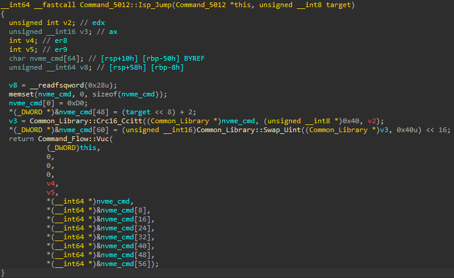
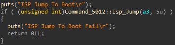

# Dumping Controller BootROM

One of the supported Phison VSCs is the *ISP Jump* command, which allows transitioning into BootROM mode. We can see a reference to this function in Crucial Executive's software binary, which also includes the command's structure:

<insert msecli screenshot here>

We note that this function has a parameter that appears to denote the jump target. By looking for some invocations of that function within Crucial Executive's binary, we can infer what value we need to pass as the jump target in order to transition into BootROM mode:

Once that VSC with the appropriate jump target is issued and the controller switches to BootROM mode, we still have access to some Phison VSCs, although the actual command set is smaller than what is available in the main firmware application.\
Notably, what we still have access to is the Phison READ VSC, which enables us to read arbitrarily from the controller's address space. This is very useful, because we can use that VSC to read the vector table of the BootROM at address *0x00000000* and then inferring where the main code block resides. For KC3000, the start address of that code block is at *0x80000*, so we start dumping the code from there until we have the entire BootROM code.
