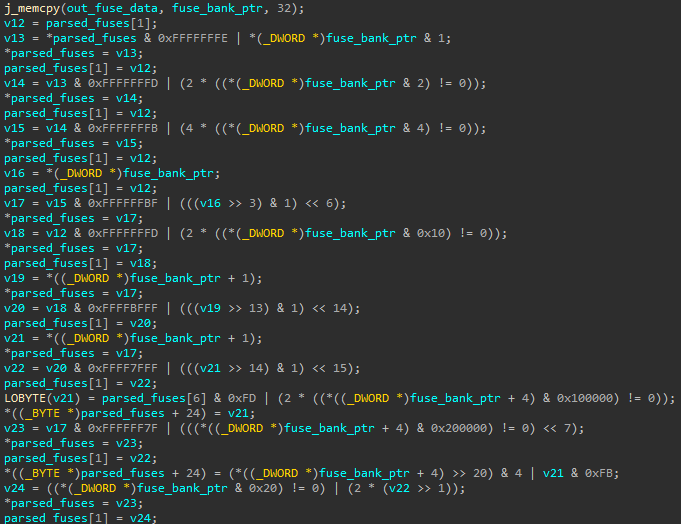
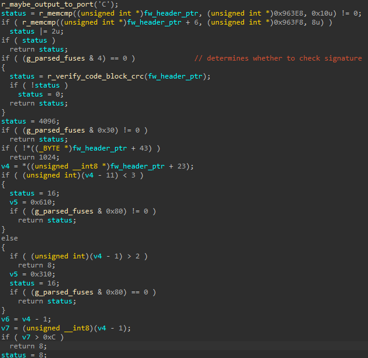
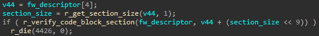

# Exploitation

## Fuse Parsing
To support Secure Boot, Phison controllers use values programmed into fuses as the root of trust in hardware. These fuses are read from the fuse banks, processed, and once that has been done, the BootROM updates a variable in RAM with the processed results, as we can see in the following snippet:

What is particularly interesting about this, is that from that point on, the BootROM consults the aforementioned RAM variable when it needs to check for the programmed security properties of the controller.

## Finding a Bypass
There is one specific condition that the BootROM checks before loading the firmware, which if that check passes, it simply verifies the validity of the CRC *instead* of verifying the firmware's signature:

We note, again, that the checked fuse bit is read from an RAM variable, not directly from the fuses, which means that if a malicious actor can manipulate that variable before this check, then they can achieve Secure Boot bypass, as computing CRC on the firmware binary is trivial.
Given the arbitrary write primitive from before, all we need to do is to simply add a patch entry that targets the variable that holds decoded fuse bits so that the BootROM would only check the CRC.

## Putting It All Together
Given everything we know, it should be fairly easy constructing a pipeline that enables a malicious actor writing an unsigned payload to the controller's non-volatile memory and having it boot successfully:

* Prepare a modified firmware image:
    - Change any bytes within the main firmware section and update the CRC field in its header (possibly also change its size if needed, that is also part of the header).
    - Prepare an information section that contains the patch entry for the BootROM's decoded fuses RAM variable (the (address, value) tuple from before that unsets the specific bit that mandates verifying the firmware's signature). Alternatively, one can simply patch the current copy of the ID Page in RAM (without having to override its values using the information section) and then trigger a *Firmware Flash* Phison VSC command to trigger writing the ID Page to non-volatile memory.
    - Prepare a *modified* Loader section. This is in fact very important, because as we saw earlier, the Loader application is the actual binary that is loaded by the BootROM. The Loader is in turn responsible for loading the main firmware application, but it in fact *verifies the signature of the main FW application*. That means, that the BootROM bypass is not enough, we need to also patch the signature check within the Loader application so that it will allow loading a patched firmware application. Failure to do so will result in the Loader hanging, possibly bricking the device, as there might not be any software-based way to recover it.\
    The CRC value within the header must also be updated accordingly.\
    

* Patch the currently running firmware (in runtime) so that it skips the decryption and signature check steps. That part is easy, given that we have volatile code execution, and the currently-running code sections are writable.

* Issue a *Firmware Flash* Phison VSC command and then reboot the controller.