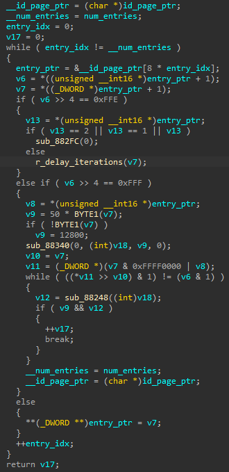

# Finding Primitives

Given the full BootROM code, we can proceed to finding primitives.

One of the concepts that is relevant here is the *ID Page*. This is a *persistent* data structure of size *0x1000* bytes that holds controller and NAND related metadata. This data structure also holds information about where the firmware application is located, which is why the BootROM searches for this page and parses it before giving control to the firmware application.\
This ID Page is *updatable* and *unsigned*, which means that anyone who has the capability to write arbitrary ID Page data has a potential attack surface in the BootROM.

Following the trail of ID Page parsing, we observe the following function, which processes a list of tuples of integers from the ID Page:

What we note is that for most tuples, the BootROM logic treats the first integer as an address and uses the second value to write it to the address, in a sense treating this list as a list of runtime patches.\
This appears to be a *feature* of the BootROM to possibly enable remedying bugs or add some functionality post silicon.\
However, this feature gives a malicious actor the capability to arbitrarily write chosen values to chosen addresses, *persistenty*, if they can control the ID Page's data. This is one of the best primitives a malicious actor can hope for.\
We note that multiple such patch entries may be included in the ID Page, but as we will see later on, we will only need one entry.
