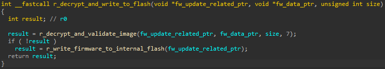
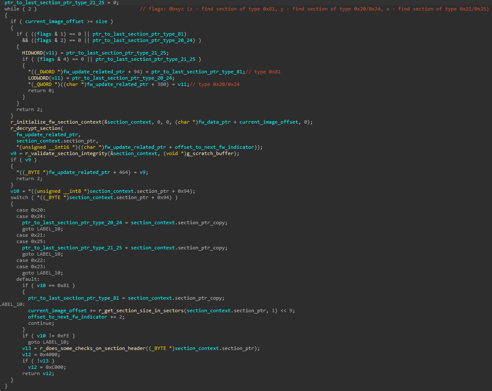
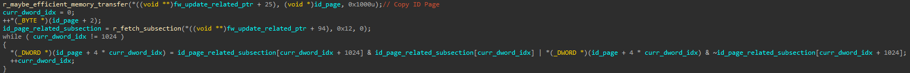
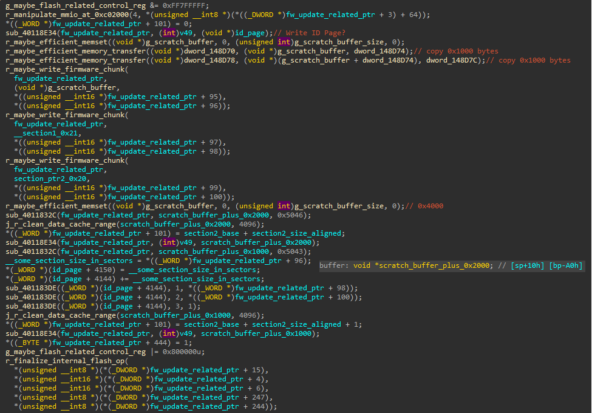

# Firmware Update Process

This section covers (in a fairly high level) what are the steps taken when a firmware update is requested.

## Firmware Update Structure Summary
The general structure of a Phison firmware update for E12/E16/E18-based drives is like so:
* Main Phison header of size 0x200 bytes which holds information about the code/info sections within the firmware image, as well as some fields that identify the controller the firmware update targets.
* A list of sections, each section includes a header of size 0x200 bytes with the *CODE BLOCK* magic.
    - An information section which does not contain code, but does contain information about the ID Page, for example.
    - (Presumably) *Loader* section, which contains the code for the firmware loader. It is a code section, which is the *actual* binary the the BootROM verifies and loads. It is responsible for loading the actual firmware application to memory.
    - *FW* section, which contains the code for the firmware application. This contains the bulk of the controller's code.

Recent firmware images are also encrypted, which means that when performing a firmware update, the currently running firmware must detect that based on the information in the sections' headers, decrypt the sections, verify them (possibly check the firmware signature) and only then write the firmware to non-volatile memory.

## Firmware Update Flows
There are two main flows which may be used to update the controller's firmware:
- The regular NVMe flow, which uses multiple *download* NVMe commands, followed by a *commit* command, which writes the accumulated firmware data to the controller's non-volatile memory.
- The Phison VSC flow, which enables updating the firmware with some fewer checks and without the main Phison header, but rather just the information and code sections glued together.

We will be using the Phison VSC flow for convenience.

## Firmware Update Overview
There are two main steps that are taken when a firmware is updated:
* Decrypt the firmware sections and verify each and every one of them.
* Write the firmware chunks to non-volatile memory.

Indeed, that is exactly what we see in the *Flash Firmware* command handler:

Within *r_decrypt_and_validate_image*, there exists logic that does exactly what one would expect:

* Locate each of the 3 sections within the firmware image.
    - For each section, if it is encrypted, decrypt it with the keys stored internally within the controller.
    - Perform sanity checks on the section.
    - Depending on the security configuration of the controller, either verify the CRC of the section or its signature.
* Keep pointers for each of the sections for further processing.

If all sections have been found and validated successfully, we enter *r_write_firmware_to_internal_flash*, which processes the information section and updates the currently active ID Page.

For example, there is logic to update the current ID Page based on values present within the information section:

We note that the information section is not signed (but might have a CRC which we must update), so an arbitrary ID Page may be provided in the firmware image.

Finally, further down, we have the actual flash writing logic that commits the firmware chunks to non-volatile memory:

